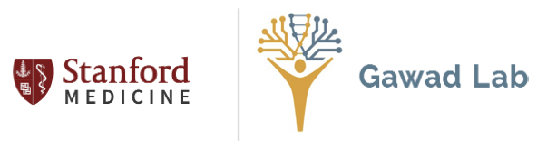

# Gawad Lab

**Stanford Medicine · Department of Pediatrics**

### Creating biotechnologies that improve human health

We invent single-cell and cell-free genomics methods, then use them to understand how childhood cancers arise, evolve, and resist treatment — and to build faster, more accurate diagnostics.

---

## What we build

Methods that read genomes, transcriptomes, and cell-free DNA at single-cell or single-molecule resolution, and the analysis code that makes sense of the result. Each row links to the papers that introduced or applied the tool.

| Tool type | What it does | Papers |
| :-- | :-- | :-- |
| **Single-cell whole-genome amplification (PTA)** | Primary template-directed amplification copies a single cell's genome uniformly enough to call point mutations, indels, and copy number in one cell; available commercially as ResolveDNA | [PNAS 2021](https://doi.org/10.1073/pnas.2024176118) · [Methods Mol Biol 2019](https://doi.org/10.1007/978-1-4939-9240-9_14) · [PLoS One 2014](https://doi.org/10.1371/journal.pone.0105585) · [Nat Rev Genet 2016](https://doi.org/10.1038/nrg.2015.16) |
| **Same-cell genome + transcriptome** | Paired DNA and full-length RNA readouts from the same cell, so a mutation can be tied to the cell state it produces; methylation and surface-protein layers are in development | [bioRxiv 2025](https://www.biorxiv.org/content/10.1101/2025.03.19.644196v2) |
| **Single-cell variant calling & clonal reconstruction** | Computational methods that separate true somatic variants from amplification artifacts and rebuild clonal trees, applied to leukemia through diagnosis, therapy, and relapse | [PNAS 2014](https://doi.org/10.1073/pnas.1420822111) · [BMC Genomics 2017](https://doi.org/10.1186/s12864-017-4286-1) · [Nat Genet 2024](https://doi.org/10.1038/s41588-024-01920-6) · [Sci Adv 2025](https://doi.org/10.1126/sciadv.adt3873) |
| **Cell-free DNA sequencing** | Plasma DNA assays that predict bloodstream infection before symptoms appear and track leukemia and microbes in the same sample | [JAMA Oncol 2020](https://doi.org/10.1001/jamaoncol.2019.4120) · [Sci Adv 2022](https://doi.org/10.1126/sciadv.abj1360) · [Lancet Microbe 2026](https://doi.org/10.1016/j.lanmic.2025.101312) |
| **Single-microbe genomics** | PTA adapted to single bacterial cells: near-complete genomes without culture | [ISME Commun 2024](https://doi.org/10.1093/ismeco/ycae085) |
| **Somatic-mosaicism detection** | Single-cell and deep-sequencing approaches that find mutations present in only a fraction of cells, from human neurons to inherited cardiac disease | [Nat Genet 2022](https://doi.org/10.1038/s41588-022-01180-2) · [PNAS 2016](https://doi.org/10.1073/pnas.1607187113) |
| **Single-cell atlases & exploration tools** | Transcriptional atlases of developing and malignant tissue, and interactive viewers for single-cell data ([CellSeek](https://github.com/GAWAD-LAB-STANFORD/CellSeek)) | [Curr Biol 2018](https://doi.org/10.1016/j.cub.2018.07.062) · [Nature 2019](https://doi.org/10.1038/s41586-019-1434-6) · [Genome Med 2023](https://doi.org/10.1186/s13073-023-01241-z) |

Full list: [gawadlab.org/publications](https://gawadlab.org/publications.html) · [Google Scholar](https://scholar.google.com/citations?hl=en&user=Nbk0c_oAAAAJ)

## Pipelines & tools

Production pipelines the lab runs on Stanford's Sherlock cluster (SLURM), released so other groups can reuse them. Each is self-contained with its own README.

| Repository | What it does |
| :-- | :-- |
| [**basejumper-sherlock**](https://github.com/GAWAD-LAB-STANFORD/basejumper-sherlock) | Run BioSkryb's open-source **BaseJumper** single-cell pipelines (`basej-dnaqc`, `-wgs`, `-rnaqc`, `-somatic`, `-lineage`, `-google-deepvariant`, `-rnaproteinqc`) on SLURM + Apptainer — cluster configs, one driver script, a 20-image container mirror on GHCR, and a BWA-MEM2 index builder |
| [**Sentieon_Pipeline**](https://github.com/GAWAD-LAB-STANFORD/Sentieon_Pipeline) | End-to-end DNA pipeline: alignment and BAM construction, QC metrics, germline and somatic variant calling, joint genotyping, Ginkgo CNV, **SCAN2** single-cell somatic calling, **PTATO**, mutational signatures (SigProfiler), and ANNOVAR annotation including **AlphaMissense** |
| [**Simple_Slurm**](https://github.com/GAWAD-LAB-STANFORD/Simple_Slurm) | Standalone SLURM scripts for the jobs that don't need a whole pipeline — SCAN2, SigProfiler, Ginkgo CNV, mosdepth, monovar, demultiplexing, tranche filtering |
| [**Single bacteria pipeline**](https://github.com/GAWAD-LAB-STANFORD/metagenomics-v3/tree/main/bacteria) | Genomes from single bacterial cells, the companion to our **single-microbe PTA** work. It runs on an **nf-core/mag** backbone: BBTools read QC, SPAdes `--sc` assembly, binning with CheckM2 and GTDB-Tk, a seven-stage decontamination chain against negative controls and `nt`, coverage uniformity (Gini), plasmids and viruses (geNomad), CRISPR spacers, biosynthetic gene clusters, and an HTML report. A cell with no reference genome is measured against the closest GTDB genome when GTDB-Tk places it in a known species. Part of metagenomics-v3, private until publication |
| [**metagenomics-v3**](https://github.com/GAWAD-LAB-STANFORD/metagenomics-v3) | Trace and fragment virus detection in human sequencing libraries, in Nextflow. Host and viral references compete in one minimap2 index, and each hit is weighed on coverage shape, alignment identity, orthogonal callers (KrakenUniq, DIAMOND), assembly with MEGAHIT, CheckV and geNomad, `nt` BLAST, and subtraction of negative controls, then tiered by a multi-tool consensus in an HTML report. Private until publication |
| [**RNA_Pipeline**](https://github.com/GAWAD-LAB-STANFORD/RNA_Pipeline) | STAR-based RNA-seq alignment, BAM construction, and quantification |
| [**SH800_Flow_Pipeline**](https://github.com/GAWAD-LAB-STANFORD/SH800_Flow_Pipeline) | Sony **SH800** flow cytometry in R: saturated-event removal, PeacoQC, debris and size-aware doublet gating, and positive gates set from matched negative controls, with PNG figures and tables; packaged with a lab Results Report builder as Claude Code skills |
| [**gawadlab.org**](https://github.com/GAWAD-LAB-STANFORD/gawadlab.org) | The lab website — plain HTML/CSS/JS, publications rebuilt from PubMed |

Also archived here: [**CellSeek**](https://github.com/GAWAD-LAB-STANFORD/CellSeek), an interactive single-cell explorer that renders large datasets by binning cells into a hexagonal grid and sending only non-zero values over the wire.

Analysis code and source data for individual studies are released alongside each publication.

---

Biomedical Innovations Building · Stanford University School of Medicine · <a href="https://gawadlab.org">gawadlab.org</a>

